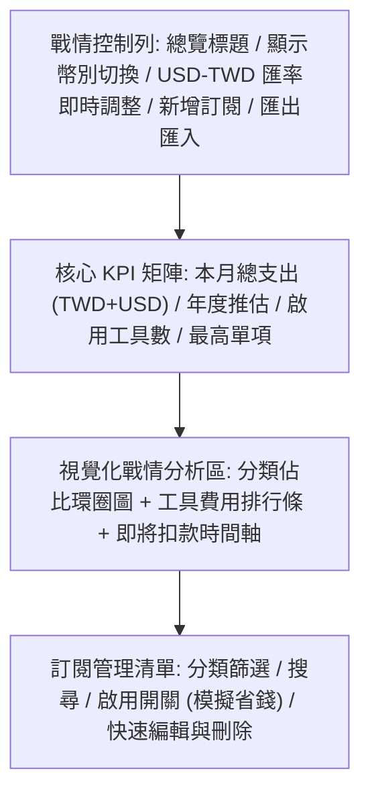

# 訂閱費用戰情室儀表板（Subscription War-Room Dashboard）實作計畫

## Goal Description
建立一套可立即啟動展示、具備「戰情室（War-Room）」視覺風格的個人訂閱費用追蹤儀表板。協助使用者快速盤點並輸入每月支付的 **AI 工具**（如 ChatGPT、Claude Code、Google AI Pro）、**文章寫作工具**（如 Medium、Substack、Notion）與 **影音平台**（如 YouTube Premium、Netflix 等），並解決 **美金（USD）與台幣（TWD）混合計費** 的痛點，即時換算統一幣別總額與年度支出推估。

## User Review Required
> [!IMPORTANT]
> **技術架構與資料儲存決策**
> 為達到「快速展示、零後端依賴、開箱即用」的目標，本計畫採用 **Vite + React + TypeScript + Tailwind CSS** 純前端架構：
> - **資料持久化**：使用瀏覽器 `localStorage` 自動儲存所有訂閱項目與匯率設定，並內建 **JSON 匯出／匯入** 與 **一鍵載入範例資料** 功能。
> - **匯率換算**：內建預設 `USD → TWD` 匯率（預設 `32.5`），提供右上角戰情控制列即時手動微調，並可選配免費公開匯率 API 一鍵更新（離線時自動退回手動匯率）。
> - **計費週期**：支援「月繳」與「年繳（自動除 12 攤提為月均費用）」，並支援「啟用／暫停」開關以進行 **省錢模擬（What-If Analysis）**。

## Proposed Changes

### 專案初始化與基礎建設 (Project Setup)
於工作區 `/Users/kennykang/Projects/AntigravityProj/ai-tools-subscription` 建立 Vite + React + TypeScript 專案，並設定 Tailwind CSS 與暗黑戰情室主題色票。

#### [NEW] [package.json](file:///Users/kennykang/Projects/AntigravityProj/ai-tools-subscription/package.json)
- 安裝核心依賴：`react`, `react-dom`, `lucide-react`（戰情室圖示）。
- 開發依賴：`vite`, `@vitejs/plugin-react`, `typescript`, `tailwindcss`, `@tailwindcss/vite`。

#### [NEW] [index.html](file:///Users/kennykang/Projects/AntigravityProj/ai-tools-subscription/index.html)
- 載入等寬數字與現代無襯線字體（`Inter` 與 `JetBrains Mono`），設定繁體中文語系與頁面標題「訂閱戰情室 | Subscription War Room」。

---

### 資料模型與匯率邏輯 (Data Model & Currency Engine)
定義強型別的訂閱資料結構、分類系統與預設展示資料，確保開箱即可展示完整戰情畫面。

#### [NEW] [src/types/subscription.ts](file:///Users/kennykang/Projects/AntigravityProj/ai-tools-subscription/src/types/subscription.ts)
```typescript
export type Currency = 'USD' | 'TWD';
export type BillingCycle = 'monthly' | 'yearly';
export type Category = 'ai' | 'writing' | 'media' | 'other';

export interface SubscriptionItem {
  id: string;
  name: string;
  category: Category;
  price: number;
  currency: Currency;
  billingCycle: BillingCycle;
  billingDay: number; // 1-31
  active: boolean;    // 用於控制是否計入總額（支援停用模擬）
  notes?: string;
  updatedAt: string;
}
```

#### [NEW] [src/data/presets.ts](file:///Users/kennykang/Projects/AntigravityProj/ai-tools-subscription/src/data/presets.ts)
- **預設展示資料（Starter Pack）**：包含 ChatGPT Plus (`$20 USD`)、Claude Code / Pro (`$20 USD`)、Google AI Pro (`$19.99 USD`)、YouTube Premium (`$199 TWD`)、Medium (`$5 USD`) 等常見訂閱，方便第一次開啟時直接展示戰情室效果。
- **快速新增模板（Quick-Add Templates）**：在新增視窗提供常見工具一鍵填入（含預設幣別與價格）。

#### [NEW] [src/utils/currency.ts](file:///Users/kennykang/Projects/AntigravityProj/ai-tools-subscription/src/utils/currency.ts)
- 實作 `getMonthlyCostInTWD(item, exchangeRate)` 與 `getMonthlyCostInUSD(item, exchangeRate)`。
- 處理年繳自動 `/ 12` 攤提與貨幣格式化（`NT$ 3,450` / `$20.00`）。

---

### 戰情室 UI 元件 (War-Room Dashboard Components)
整體採用深色高科技戰情室風格（深炭黑背景 `#090D16`、卡片玻璃擬態邊框、霓虹青/琥珀金/紫羅蘭分類識別色、`tabular-nums` 等寬數字對齊）。



#### [NEW] [src/components/HeaderBar.tsx](file:///Users/kennykang/Projects/AntigravityProj/ai-tools-subscription/src/components/HeaderBar.tsx)
- 顯示戰情室標題與即時總覽狀態指示燈。
- **匯率控制器**：可直接輸入調整 `1 USD = __ TWD`（即時重算全畫面數字），並附帶「抓取即時匯率」按鈕。
- **主幣別切換**：一鍵切換「以 TWD 為主顯示」或「以 USD 為主顯示」。
- **操作按鈕**：`+ 新增訂閱`、匯出 JSON、匯入 JSON、重置範例資料。

#### [NEW] [src/components/KpiGrid.tsx](file:///Users/kennykang/Projects/AntigravityProj/ai-tools-subscription/src/components/KpiGrid.tsx)
- 4 張戰情 KPI 卡片：
  1. **本月實際總支出**：主數字顯示換算後總額，副標拆解「美金計價總額」與「台幣計價總額」。
  2. **年度支出推估**：`月均總額 × 12`，並顯示若將目前已暫停項目算入的潛在差異（節省金額）。
  3. **訂閱工具統計**：啟用中 / 總項目數，以及「AI 工具佔總支出百分比」。
  4. **最高支出項目 & 近期扣款**：標示花費最高的單一工具與下一個即將扣款日。

#### [NEW] [src/components/AnalyticsSection.tsx](file:///Users/kennykang/Projects/AntigravityProj/ai-tools-subscription/src/components/AnalyticsSection.tsx)
- **分類佔比環圈圖（SVG Donut Chart）**：純輕量 SVG 繪製，無需額外肥大圖表庫，支援滑鼠懸停顯示各分類（AI 工具 / 文章寫作 / 影音平台 / 其他）的金額與百分比。
- **支出排行與幣別結構**：列出前幾大支出工具的水平進度條（同時標註原幣別與換算台幣），以及 USD vs TWD 付款比例條。
- **本月扣款雷達**：依 `billingDay` 排序顯示接下來即將扣款的項目。

#### [NEW] [src/components/SubscriptionTable.tsx](file:///Users/kennykang/Projects/AntigravityProj/ai-tools-subscription/src/components/SubscriptionTable.tsx)
- 支援依分類（全部 / AI 工具 / 文章寫作 / 影音平台 / 其他）切換 Tab 與關鍵字搜尋、金額排序。
- 每一列提供：
  - **啟用／暫停撥動開關**：點擊可即時將該工具移出本月計算，測試「取消訂閱後每月能省多少」。
  - **原幣別金額** 與 **換算後台幣月費**（年繳會標示 `年繳攤提` 標籤）。
  - 扣款日標記、編輯與刪除按鈕。

#### [NEW] [src/components/SubscriptionModal.tsx](file:///Users/kennykang/Projects/AntigravityProj/ai-tools-subscription/src/components/SubscriptionModal.tsx)
- 新增／編輯訂閱的彈窗表單。
- 頂部提供「快速帶入常見工具」膠囊按鈕（ChatGPT, Claude Code, Google AI Pro, Cursor, YouTube Premium, Medium, Netflix, Spotify），點擊一秒填入名稱、分類與預設價格，再依個人方案微調即可。

---

## Verification Plan

### Automated Tests
1. **TypeScript 型別檢查與建置驗證**：
   ```bash
   npm run build
   ```
   確認無任何 TypeScript 編譯錯誤與 Vite 打包警告。

### Manual Verification
1. 啟動開發伺服器 `npm run dev` 並於瀏覽器開啟儀表板。
2. **雙幣別與匯率測試**：修改右上角 `USD → TWD` 匯率（例如從 `32.5` 改為 `30`），驗證美金計價工具（ChatGPT / Claude Code / Google Pro）的台幣換算與總支出即時連動，且台幣計價工具（YouTube）原幣別金額維持不變。
3. **新增／編輯與模擬省錢測試**：透過快速模板新增一筆工具、切換年繳／月繳確認攤提計算正確；切換任一項目的「啟用／暫停」開關，確認 KPI 總額與圖表即時更新。
4. **持久化測試**：重新整理頁面，確認資料與自訂匯率皆保留於 `localStorage`。
